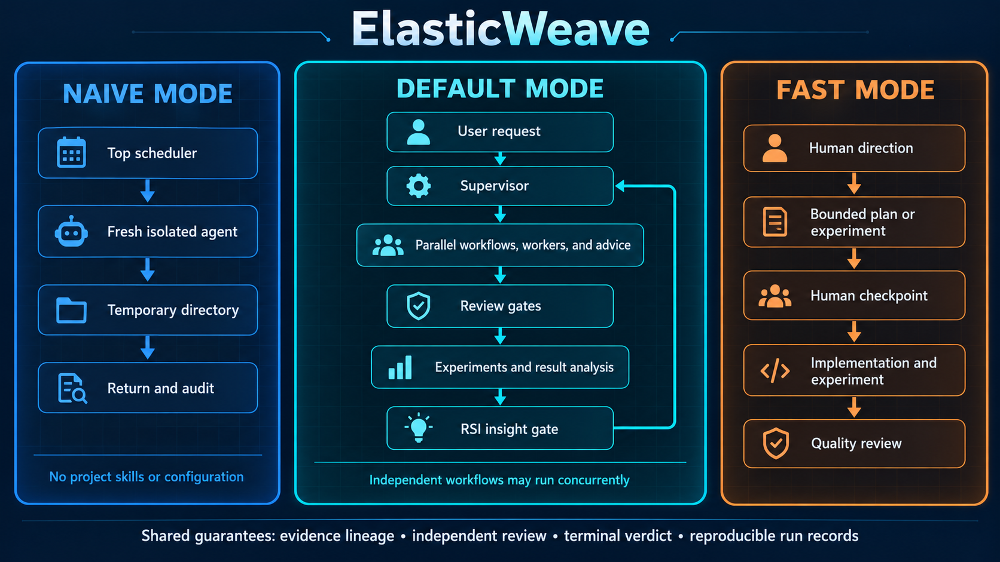
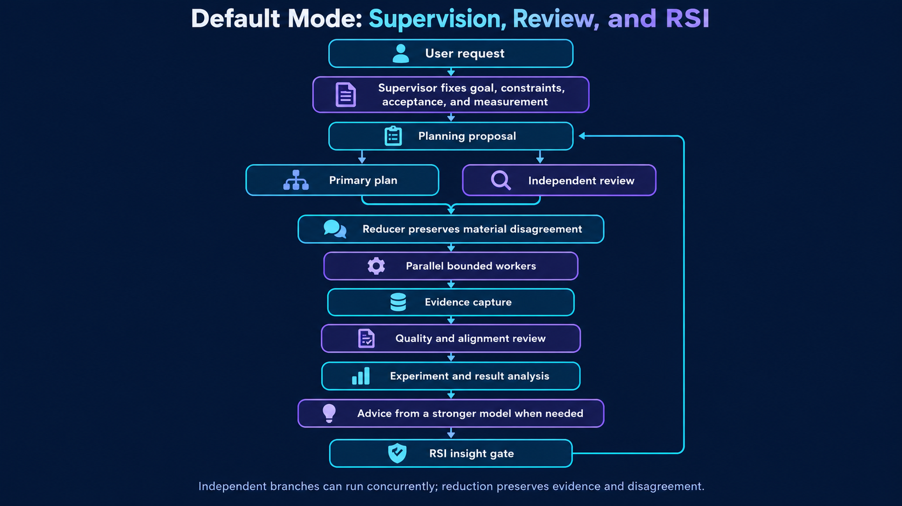
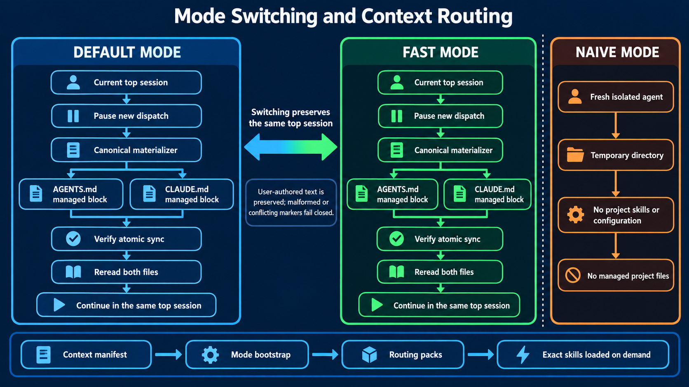

# ElasticWeave

**[中文说明](README.zh-CN.md)**

ElasticWeave helps coding agents work on long-running optimization, research, and algorithm or
proof problems. A supervisor delegates work to specialist agents, brings in other models for
advice and review, and uses the results to decide what to try next.



## Quick Start

### 1. Prepare a Linux machine

Install Git, Python 3, curl, and unzip using your system package manager, then install the agent
CLIs and Bun:

```bash
curl -fsSL https://chatgpt.com/codex/install.sh | sh
curl -fsSL https://claude.ai/install.sh | bash
curl https://cursor.com/install -fsS | bash
curl -fsSL https://bun.com/install | bash
```

Follow the installers' PATH instructions. Run `codex`, `claude`, and `agent login` to authenticate
the selected accounts. See the official [Codex](https://developers.openai.com/codex/cli/),
[Claude Code](https://code.claude.com/docs/en/setup),
[Cursor](https://cursor.com/docs/cli/installation), and [Bun](https://bun.sh/docs/installation)
instructions for platform-specific setup.

The [bundled model policy](.claude/skills/default-mode/assets/project/config/workflows/models.json)
currently prefers **GPT-6 Astra + Claude Opus 5**. It uses both Codex and
Anthropic models, including Cursor routes. Tell the agent which accounts and models you can access;
it checks availability before use and reports unavailable selections. Other combinations need
explicit configuration; OpenCode is not currently a drop-in replacement for Cursor in the default
runtime.

Please add more concurrency for codex if your token is billed by api.
```toml
[agents]
enabled = true
max_concurrent_threads_per_session = 20
```

### 2. Add ElasticWeave to your project

```bash
git clone git@github.com:ElasticWeave/ElasticWeave.git "$HOME/elasticweave"
mkdir -p /path/to/your-project
cd /path/to/your-project
git init  # Skip if this is already a Git repository.
```

For a project without existing skills, copy the package and expose it to Codex:

```bash
(
  set -eu
  # Stop before copying if either skill location already exists.
  test ! -e .claude/skills
  test ! -L .claude/skills
  test ! -e .agents/skills
  test ! -L .agents/skills
  mkdir -p .claude .agents
  cp -a "$HOME/elasticweave/.claude/skills" .claude/skills
  ln -s ../.claude/skills .agents/skills
  for entry in '/.claude/skills/' '/.agents/skills'; do
    grep -qxF "$entry" .gitignore 2>/dev/null || printf '\n%s\n' "$entry" >> .gitignore
  done
)
```

If the project already has skills, use the update prompt below to merge them. Keep your own skills
and agent settings; copying the entire package's hidden directories is unnecessary.

### 3. Start a task

Run `codex` from the project directory. Choose a mode:

| Mode | Who provides the plan? | Use it for |
| --- | --- | --- |
| `$default-mode` | The agent proposes and refines it, with review where useful. | Autonomous research, implementation, and optimization. |
| `$fast-mode` | You provide the direction or plan; the agent executes a short cycle and checks back. | Quick experiments and aligning the agent with your intent. |
| `$naive-mode` | One isolated agent works from a self-contained brief. | Ablations and baseline comparisons. |

For Default mode, replace the angle-bracket fields and paste:

```text
$default-mode
Goal: <task and measurable success criteria>.
Repository and branch: <path or URL, branch>; <push allowed / do not push>.
Acceptance: <what the agent should verify and what needs my review>.
Constraints and resources: <rules, data, compute, time or cost budget>.
Models: <authenticated CLIs/models, or use the bundled recommendations after checking access>.
Context: <relevant files and existing session IDs, if any>.
Continue until the agreed goal is met or a concrete blocker needs my input.
```

For Fast mode, use the same fields but start with `$fast-mode` and give your plan:

```text
$fast-mode
My plan: <specific change or experiment>. Implement it, run the checks, and show me the result
before choosing the next direction.
```

For a baseline, supply everything the isolated agent needs in the prompt:

```text
$naive-mode
Task: <self-contained problem, inputs, constraints, and expected output>.
```

Naive mode runs in a temporary directory without project code, skills, configuration, or session
history. Its output returns to the current session; it does not modify your project.

Send new information or corrections directly in the main session. Ask for progress or whether
anything needs your input; in Codex versions that support [`/side`](https://developers.openai.com/codex/cli/slash-commands/), you can use
`/side What's the current progress?` while work continues.

## How it works

In Default mode, the top agent supervises a cycle of planning, delegated implementation,
experiments, and result analysis. Independent reviewers challenge important plans and check the
work. When results are surprising or progress stalls, stronger models can offer advice. Planning,
advice, and analysis can interleave; you do not need to choose workflow templates yourself.



- **Concurrent work:** independent workers and workflows can run in parallel. The diagrams' serial
  controller note refers to branches *within one workflow*, not to the supervisor's separate jobs.
- **Self-improvement:** the supervisor uses observed results to revise workflows and retain reviewed
  improvements for later work. This changes the working process, not the underlying model weights.
- **Focused context:** workers receive the task and skills they need, while the supervisor keeps
  track of the overall goal.

Fast mode follows your direction with less discussion of the idea itself. Implementation checks
and independent review remain part of the work. You can start with Fast mode, confirm that the
agent understands your intent, and then switch to Default mode for autonomous optimization.

To switch, send `$default-mode` or `$fast-mode` with your next instruction **in the same session**.
The agent settles ongoing work, updates the managed sections of `AGENTS.md` and `CLAUDE.md`, rereads
them, and continues. Your own instructions and task history are preserved.



## Adopting updates

Update the package checkout:

```bash
git -C "$HOME/elasticweave" pull --ff-only
```

Then send this in your **existing project session**, replacing the source path and active mode:

```text
Install or update ElasticWeave from <absolute path to the package checkout> in this project.
Read its .claude/skills/default-mode/references/installed-project-layout.md first.
Merge the package skills into .claude/skills and expose them through .agents/skills.
Preserve my own skills, settings, local edits, task state, and memory; reconcile conflicts and
retired package files explicitly. Ignore only installed package files in Git.
Refresh the managed AGENTS.md and CLAUDE.md sections for <default / fast> mode, reread the updated
instructions and relevant task context, and continue the current task in this same session.
```

The agent handles package changes and instruction refresh together. No new top session is required.

## Citation

If you use ElasticWeave in your research, please cite it as:

```bibtex
@misc{li2026elasticweave,
  author       = {Li, Muheng},
  title        = {ElasticWeave},
  year         = {2026},
  publisher    = {GitHub},
  journal      = {GitHub repository},
  howpublished = {\url{https://github.com/ElasticWeave/ElasticWeave}}
}
```

## Sponsorship

For sponsorship enquiries, please contact muhengli2005@gmail.com.

## License

[MIT](LICENSE).
